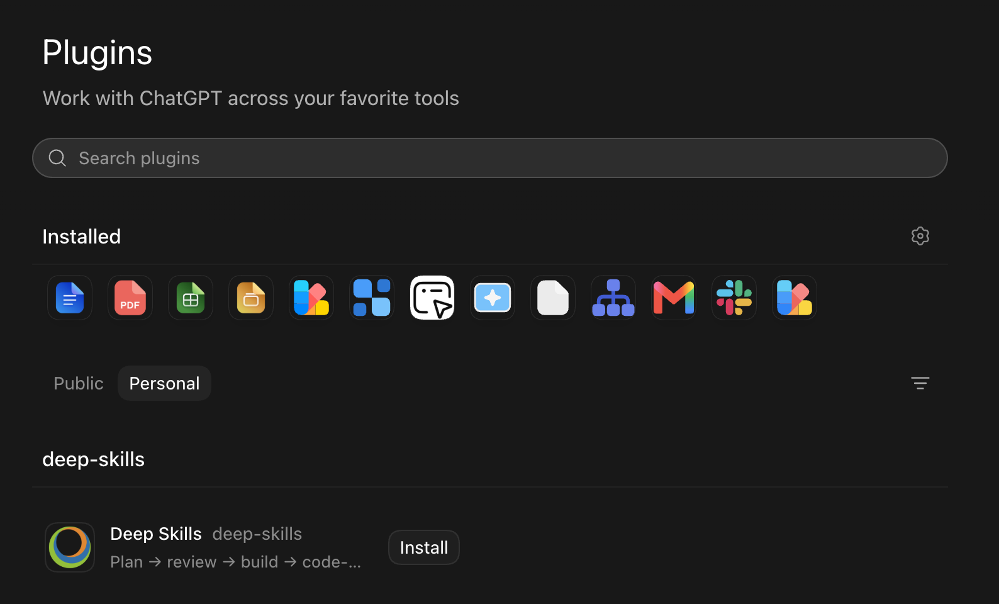

# Hosts & distribution - installing deep-skills across assistants

The deep-* skills are **one set of skills** (the `skills/<name>/SKILL.md` + `references/` + `scripts/` + `templates/` layout every modern agent host reads). This repo adds **thin per-host manifests** so each assistant installs the *same* skills natively. **Skill bodies are never forked per host** - the only per-host files are the manifest directories below.

> **Add-on note:** an optional, separately-installed **deep-goal** plugin (a free pipeline conductor that runs the six skills end-to-end) **works with** this plugin - it is never required by it, and nothing here depends on it. deep-goal has its own host matrix and install steps: [`plugins/deep-goal/HOSTS.md`](../deep-goal/HOSTS.md).

> **Status - schema/capability gates are DEFERRED.** The manifests here were authored against each host's official marketplace docs (mid-2026) but the **empirical capability-verification gate (M3)** - install on the host, run a full `deep-plan → deep-code-review` cycle, and confirm (a) load + NL/slash invocation, (b) parallel fan-out actually runs, (c) per-agent model selection binds - every launched agent actually runs on the full model ID the shared model map (`references/model-map.json` + `model-map.md`) resolves for it, including `--max` and the access fallback - has **not** been run. Run it per host before treating that host as committed. Items marked **RE-VERIFY** are schema/command details that move fast and must be re-checked against current docs at install time.

## The vendoring invariant (why directives live next to skills)

The Deep-Learn directive loader (`skills/<name>/scripts/load-active-cards.sh`) is **self-locating**: it resolves the shared registry **relative to its own file**, three levels up - `skills/<name>/scripts/ → ../../../directives/cards/active`. For that to resolve on any host, the installed unit must keep `skills/` and `directives/` as **siblings** under one plugin root.

That is exactly why every per-host manifest lives **inside `plugins/deep-skills/`** (alongside `.claude-plugin/`) and points `"skills": "./skills/"`: the vendored package is the plugin root, so `directives/` rides along as a sibling and the relative path keeps working **unchanged** on every host. This is the **primary** §C fix - no edit to the byte-identical `load-active-cards.sh`.

- **Non-shell hosts** (or installs where the sibling layout isn't preserved - e.g. copying only `skills/` into a VS Code editor folder): apply directive cards by hand instead - read `directives/cards/active/` and apply each card whose `owner_phases` lists the phase as an exact token. See any skill's `references/host-affordances.md` § *Directive-card loading without a reliable shell*.

## Model-tier routing is portable, and required

Every host below supports **per-agent model selection** in its subagent/agent definition. Every skill that launches agents - the fleets (`deep-code-review`, `deep-plan-review`, `deep-bugfix`, `deep-docs`) and the helper agents of `deep-plan` and `deep-implement` - **must** set each agent's model explicitly, as a full model ID, from the shared model map before launch - a correctness guarantee, not an affordance (see `references/host-affordances.md`). The map is two byte-identical files in every skill: `references/model-map.json` (the data - the only place model IDs live) and `references/model-map.md` (the rules). It is **host-agnostic**: the same files resolve on every host; no per-host copies.

- **Three fixed levels.** **smartest** (Fable 5.2, then Fable 5; Astra-6 on GPT), **smarter** (Opus 5.5, then Opus 5; GPT-6-Sol), **smart** (Sonnet 5.5, then Sonnet 5; GPT-6.1-Terra) - the floor. A level always means the same models, whatever model your session runs, and a run stays in your session's model family (Claude or GPT). Every level is a reasoning model; small models (Haiku, GPT-mini/nano) are never used. GPT names are display names until the host IDs are confirmed (RE-VERIFY).
- **`--max=<smartest|smarter|smart>`** on every skill sets the highest level a run's agents may use; it defaults to your current model's level. With smartest, planning, plan review and code review run on Fable 5.2, building and bug fixing on Opus 5.5, and docs on Sonnet 5.5. Each skill's own agent table then puts some helpers lower - for example, deep-code-review's quality checker runs on Sonnet 5.5.
- **Your current model runs the inline work** - the interactive planning conversation, synthesis done in your session. Helper agents may run above it; that is intended.
- **Access fallback.** If your plan or org blocks a model, the agent tries the same level's previous generation, then the next level down (never below smart). Each report records the models that actually ran.
- **Repo override.** An optional `.deep-skills/model-map.json` at the repo root repins a model or moves a stage's level for every skill and deep-goal - e.g. `{"stages":{"smartest":{"docs":"smarter"}}}` runs docs on Opus 5.5 when you choose smartest. It is validated at launch; an invalid one stops the run before anything starts.

**A host that cannot bind per-agent models routes its fleets to a single-agent fallback for that host only** (see the matrix).

## Capability matrix (from official docs; ✓ = documented, ⚠ = degrade, gate = verify empirically)

| Capability | Claude Code | Codex | Cursor | Copilot / VS Code |
|---|---|---|---|---|
| `SKILL.md` skills | ✓ | ✓ GA | ✓ GA | ✓ GA (VS Code 1.108+, stable Jan 2026) |
| Parallel subagent fan-out | ✓ | ✓ (`[features] multi_agent=true`) | ✓ (`/multitask`, Task fan-out) | ⚠ **sequential `handoffs` only - no documented parallel fan-out** |
| Per-agent model selection | ✓ | ✓ (`.codex/agents/*.toml` `model`) | ✓ (`.cursor/agents/*.md` `model:`) | ✓ (`*.agent.md` `model:`) |
| Per-agent reasoning effort | ✓ | ✓ (`model_reasoning_effort`) | ✗ | ✗ (not documented) |
| NL + slash/selector invocation | ✓ `/x` | ✓ `/skills` + NL | ✓ `/x`, `@`, NL | ✓ `/x` + NL |
| Structured-question UI | ✓ `AskUserQuestion` | chat fallback | chat fallback | chat fallback |
| Artifact writes (`.deep-skills/**`) | ✓ | ✓ | ✓ | ✓ |

**Copilot/VS Code degradation (gate-b risk).** VS Code Copilot's custom-agents docs describe **sequential** handoffs, not concurrent fan-out. If the M3 gate confirms no parallel fan-out: `deep-plan` and `deep-implement` run fully (their helper agents run one at a time); the **fleet** skills (`deep-code-review`, `deep-plan-review`, `deep-bugfix` - per-cluster diagnose and fix agents plus fresh proof agents - and `deep-docs` - per-boundary survey and per-card anchor-verify agents) route to their sequential single-agent fallback on this host only. Re-verify against current docs - VS Code agent features move fast.

## Per-host install

### Claude Code (reference host - shipped)
Add the marketplace, install the plugin:
```
/plugin marketplace add reurgency/marketplace
/plugin install deep-skills@reurgency
```
Manifests: `.claude-plugin/marketplace.json` (repo root) + `plugins/deep-skills/.claude-plugin/plugin.json`.

### Codex (manifest authored - gate pending)
Codex reads `SKILL.md` natively and has a plugin marketplace.
```
codex plugin marketplace add reurgency/marketplace     # RE-VERIFY exact subcommand/flags
# then in Codex: /plugins → search "deep-skills" → Install
```



Manifest: `plugins/deep-skills/.codex-plugin/plugin.json` (`"skills": "./skills/"`). Codex also accepts `.claude-plugin/marketplace.json` as a legacy/compat marketplace source. For the fleets, enable fan-out (`[features] multi_agent = true` in `~/.codex/config.toml`) and ship `.codex/agents/*.toml` with per-agent `model` resolved from the shared model map (`references/model-map.json`).
**RE-VERIFY:** the official Codex marketplace path is `.agents/plugins/marketplace.json` (add one if the legacy `.claude-plugin` source isn't honored on the target version); exact `codex plugin marketplace add` flags; per-skill `agents/openai.yaml` metadata.

### Cursor (manifest authored - gate pending)
Cursor reads `SKILL.md` natively and has a plugin marketplace.
```
# In Cursor Agent chat:
/add-plugin deep-skills          # RE-VERIFY - used in the wild, not on an official docs page
# or: Customize panel → Marketplace → install
# Local dev/test: copy plugins/deep-skills/ into ~/.cursor/plugins/local/deep-skills/ → Reload Window
```
Manifest: `plugins/deep-skills/.cursor-plugin/plugin.json` (`"skills": "./skills/"`). Fleets use `.cursor/agents/*.md` with `model:` from the shared model map (`references/model-map.json`); `/multitask` and Task fan-out provide concurrency.
**RE-VERIFY:** `/add-plugin` command; SKILL.md frontmatter beyond `name`/`description`/`paths`; how to surface `directives/` (no native Cursor slot - the vendoring invariant + shell loader cover it; the no-shell fallback covers the rest).

### GitHub Copilot - CLI (reuses the Claude marketplace)
Copilot CLI consumes `.claude-plugin/marketplace.json` directly:
```
copilot plugin marketplace add reurgency/marketplace
copilot plugin install deep-skills@reurgency
/skills list                     # verify
```

### GitHub Copilot - VS Code editor (file-based; no marketplace)
The VS Code editor has **no skills marketplace** - point it at this repo's skills:
- Set `chat.agentSkillsLocations` to the repo's `plugins/deep-skills/skills` (preferred - no duplication), **or** copy/symlink the skill dirs into `.github/skills/` (VS Code also reads `.claude/skills/` natively).
- Map `directives/` to always-on context via `.github/instructions/*.instructions.md`, or rely on the no-shell directive fallback.
- **Fleet caveat:** see the degradation note above.

## Updating

Third-party marketplace plugins are **not** auto-updated - pull new versions explicitly. **deep-goal** is a separate (free) plugin bundled in the same marketplace; it requires **deep-skills ≥ 0.3.0**, so update deep-skills first, then add deep-goal.

### Claude Code
```
/plugin marketplace update reurgency
/plugin update deep-skills@reurgency
/plugin install deep-goal@reurgency        # if you don't have the conductor yet
```

### GitHub Copilot - CLI
```
copilot plugin update deep-skills@reurgency     # or: copilot plugin update --all
copilot plugin install deep-goal@reurgency
copilot plugin list                             # verify
```
Copilot auto-updates only **first-party** plugins on session start; third-party marketplaces (this one) need the manual `copilot plugin update`. There is **no** `copilot plugin marketplace update` subcommand today (an open feature request) - `plugin update` fetches the latest from the registry directly, so no separate catalog refresh is needed.

### Codex / Cursor (gate pending - RE-VERIFY)
Codex: `codex plugin marketplace update reurgency` (RE-VERIFY the subcommand), then reinstall/update via `/plugins`. Cursor: update from Customize → Marketplace. Install the deep-goal plugin the same way on either.

### GitHub Copilot - VS Code editor (file-based)
`git pull` your checkout of this repo - the `chat.agentSkillsLocations` path already points at it. To add the conductor, include `plugins/deep-goal/skills` alongside `plugins/deep-skills/skills`.

## Maintainer rules (the standalone / single-source contract)

1. **One source of truth.** Skill bodies are shared across all hosts. Never fork a `SKILL.md` or `references/*` per host - fix it once, it ships everywhere. The only per-host files are the manifest dirs (`.claude-plugin/`, `.codex-plugin/`, `.cursor-plugin/`). The model map (`references/model-map.json` + `model-map.md`) is **not** forked per host - it is one host-agnostic pair; each run reads the column for its session's model family (Claude or GPT).
2. **Byte-identical shared files (standalone rule).** Any edit to a shared file is made in the **canonical copy** (under `skills/deep-code-review/`) and applied **identically** to every copy, then the consistency sweep re-run. Five shared files, each in **7 copies** - the six deep-skills skills (`deep-plan`, `deep-plan-review`, `deep-implement`, `deep-code-review`, `deep-bugfix`, `deep-docs`) plus deep-goal:
   - `references/model-map.json` - the ladder and the `--max` stage table (the only place model IDs live).
   - `references/model-map.md` - the rules for reading it (never restates an ID).
   - `references/host-affordances.md`
   - `references/artifact-structure.md`
   - `scripts/load-active-cards.sh`

   **`scripts/check-shared.sh`** (repo root - **not shipped; maintainers only**, no manifest references it) automates the sweep: `--shared` (default) compares every copy with the canonical one and validates `model-map.json` (plus any `.deep-skills/model-map.json`), never fixing anything; `--sync` copies the canonical over every copy, then runs `--shared`; `--stale` greps the repo for old tier words and model IDs left in docs; `--all` = `--shared` + `--stale`. It exits 0 only when every requested check passes. Per-agent tier tables are **not** shared - each skill keeps its own in its references.
3. **Every change must work on all hosts.** No edit may assume a Claude-only affordance at a call site - route optional affordances through `host-affordances.md`; keep model routing bound through the shared model map (`model-map.json` + `model-map.md`).
4. **Never touch frontmatter casually.** `name:`/`description:` drive auto-load/discovery on every host. Changing them changes invocation everywhere.
5. **Run the M3 gate before committing a new host.** Manifest authored ≠ host supported. Install, run a real cycle, confirm fan-out + model binding + directive-registry load, then update the matrix above.
